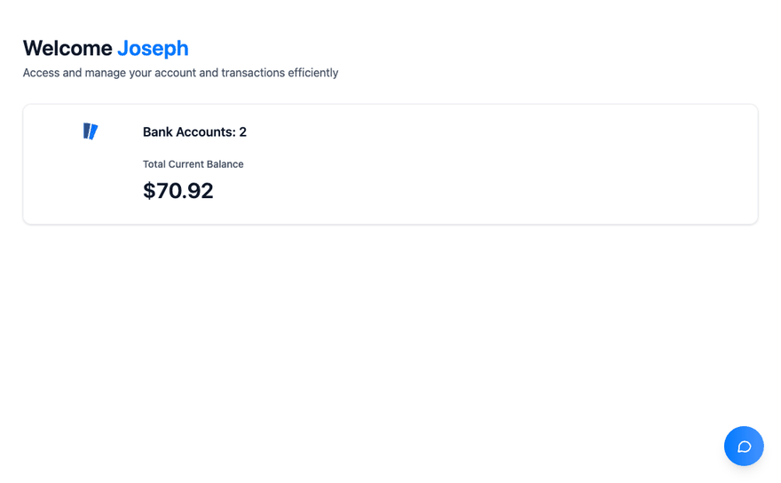
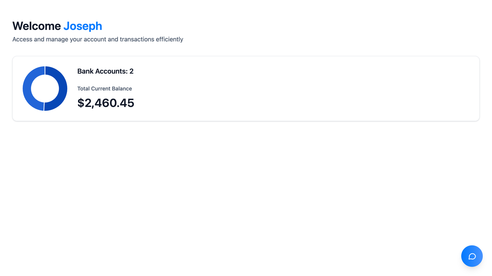
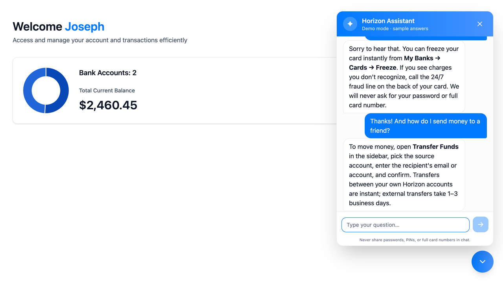
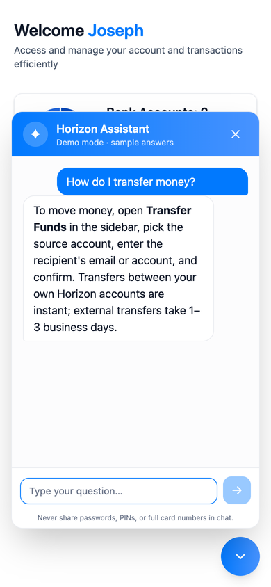

<div align="center">

# 🌅 Horizon

**Your money, at a glance. A modern banking dashboard with a built-in support assistant.**




</div>

## ✨ What's inside

| | |
|---|---|
| 💰 **Balance at a glance** | Your total balance counts up on load, with a doughnut chart showing how it's split across accounts. |
| 💬 **Horizon Assistant** | A chat bubble in the bottom-right corner. Click it and it grows into a chat window: ask about transfers, lost cards, fees, or signing in, and answers stream in as they're written. |
| 🆓 **Free demo mode** | With no API key, the assistant answers common questions from built-in replies, so it costs nothing to run. Add a key and it switches to Claude. |
| 🛡️ **Safe by default** | The assistant never asks for passwords, PINs, or card numbers. The chat API validates every request and rate-limits each visitor. |
| ♿ **Accessible** | Keyboard friendly (Enter to send, Escape to close, focus returns where you were), screen-reader labels, and reduced-motion support. |
| 📱 **Works on phones** | The chat window fits any screen down to 320px wide. |

## 📸 Screenshots

| Dashboard | Assistant | On a phone |
|---|---|---|
|  |  |  |

## 🚀 Get started

You'll need **Node.js 20.9 or newer**.

```bash
npm install
npm run dev        # → http://localhost:3000
```

That's it: the dashboard runs on sample data and the assistant runs in free demo mode.

### 🤖 Turn on real AI answers (optional)

```bash
cp .env.example .env.local   # then set ANTHROPIC_API_KEY in .env.local
```

The assistant uses **Claude Opus 5.5** at low effort, which keeps support answers fast and short. Each message is billed to your Anthropic account, so leave the key unset if you just want to explore. The chat header says **"Demo mode"** whenever you're on the free answers.

The assistant allows 300 messages overall every 10 minutes, plus 20 per visitor when it can tell visitors apart: automatically on Vercel, or when you self-host behind a proxy that sets `X-Real-IP` and set `TRUST_PROXY_IP_HEADER=true`. For a hard dollar ceiling, set a spend limit on your API key's workspace in the Claude Console.

## 🧰 Scripts

| Command | What it does |
|---|---|
| `npm run dev` | Start the dev server (Turbopack) |
| `npm run build` | Production build, including a typecheck |
| `npm start` | Serve the production build |
| `npm run lint` | ESLint with the Next.js rules |
| `npm run typecheck` | TypeScript in strict mode |
| `npm test` | Unit tests with Node's built-in test runner, no extra packages needed |

## 🗺️ How it's organized

```
app/
  (root)/          signed-in pages: dashboard + the assistant
  (auth)/          sign-in and sign-up (placeholders for now)
  api/chat/        streams assistant replies (Claude or demo answers)
  globals.css      Tailwind 4 theme (@theme) and custom classes (@utility)
components/        UI: HeaderBox, TotalBalanceBox, DoughnutChart, ChatAgent…
lib/
  chat.ts          request validation, demo answers, rate limiting (+ chat.test.ts)
  utils.ts         formatting helpers (+ utils.test.ts)
constants/         sidebar links and category styles
types/             shared types
```

Imports use the `@/` alias for the project root, e.g. `@/components/ChatAgent`.

## 🛣️ Roadmap

- [x] Dashboard with total balance and account chart
- [x] Horizon Assistant with streaming answers and free demo mode
- [ ] Sidebar navigation
- [ ] Sign in and sign up (Appwrite)
- [ ] Real bank data via Plaid (sandbox)
- [ ] Transaction history and transfers
- [ ] Error monitoring (Sentry)
